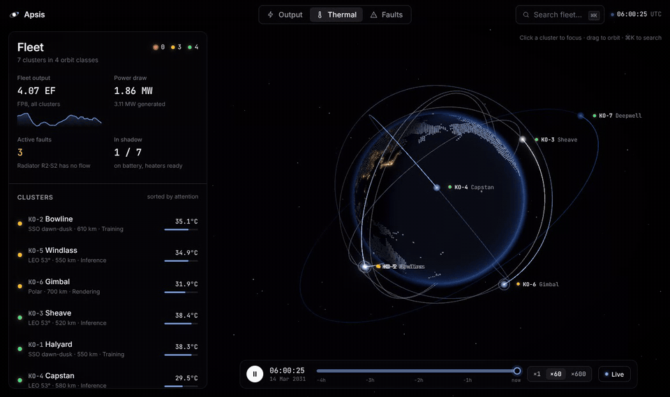

# Apsis

Envisioning what a management tool for data centers in space would look like.

**[Open the live app →](https://albsramos.github.io/apsis/)**



Seven compute clusters circle the Earth. Apsis answers the four questions a maintainer has about each one, at a glance:

| Question | Where you see it |
|---|---|
| Is it producing? | **Output** lens · output, utilisation, power margin |
| Is anything breaking? | **Faults** lens · severity-sorted faults, each linked to the part |
| Is it holding temperature? | **Thermal** lens · module and radiator heat, coolant flow, the chart of the last three orbits |
| Where is it? | Orbit rings, ground track, next eclipse, next SAA transit, next ground contact |

Click a cluster (or press ⌘K) and the camera flies in. The cluster's model unfolds, its wings tracking the Sun and its
radiators held edge-on to it. The left sheet then switches to that cluster's details.

## The fleet tells a story

The simulation is deterministic and physics-driven, so what you see has a cause:

- **KO-5 Windlass**: a coolant pump is wearing out. Flow drops, the module-to-loop ΔT widens, the thermal margin
  shrinks, and eventually the scheduler throttles output to stay under the limit. Watch it at ×600.
- **KO-2 Bowline**: a micrometeoroid punctured a radiator segment. In the Thermal lens it is the one cold panel.
- **KO-6 Gimbal**: a solar-wing drive stalled. One wing stops tracking, and power dips once per orbit.
- **KO-1 / KO-2** fly dawn-dusk sun-synchronous orbits and never see eclipse: the calm control group.
- **KO-3, KO-4, KO-5** at 53° cross Earth's shadow every orbit. The loop cools in each eclipse and heaters hold it.
- **KO-7 Deepwell**, lightly loaded cold storage, runs on heaters in shadow.
- Everyone collects radiation upsets over the **South Atlantic Anomaly** (shown on the globe in the Faults lens).

## The clusters are drawn to scale

Each cluster's model is built in metres from an engineering design, not sketched. The design is drawn up for KO-1
Halyard in **[docs/halyard-general-arrangement.pdf](docs/halyard-general-arrangement.pdf)**: three views, a section
through a compute module, the coolant loop, and the sums behind the sizes. At 420 kW Halyard stands 106 m tall, and
its six compute modules are 2.4 m canisters on a 30 m truss. Almost everything else is solar wing and radiator.

The dimensions live in `src/sim/design.ts`. Every cluster shares Halyard's truss, modules and bus, with wings and
radiators sized to its own power and heat. How a cluster flies depends on its orbit: where the Sun stays near the
orbit plane the wing booms lie across the orbit and the wings turn once a revolution; in a dawn-dusk orbit the
cluster rolls a quarter turn and stands its booms on the local vertical, so the wings can face a Sun that sits
broadside. Only the coolant, data and power lines are exaggerated (about three times their bore) so their flow reads.

## Keys

`⌘K` search · `1 2 3` lenses · `J / K` next / previous cluster · `F` follow · `Space` play / pause · `?` explain · `Esc` back

## What every number means

Press **Explain** (or `?`) and every section and headline number shows, in one line, what it measures. Click any
ⓘ or dotted-underlined label for the full story: what it is, how the model computes it, and the thresholds that
turn it yellow or red. The same text, laid out for presenting, is in [docs/METRICS.md](docs/METRICS.md); the
in-app copy lives in `src/lib/glossary.ts`.

## Run it

```bash
npm install
npm run dev        # http://localhost:5173
npm run build      # typecheck + production build
npm run sim:check  # assert the simulation's stories hold
npm run build:pages  # the GitHub Pages build (hash routes, relative paths) in dist-pages/
```

Every push to `main` builds `dist-pages/` and publishes it to the `gh-pages` branch
(`.github/workflows/pages.yml`), which GitHub Pages serves at https://albsramos.github.io/apsis/. Links to a cluster
look like `…/apsis/#ko-5`.

The Pages build is an installable PWA: open it in Chrome, Edge or Safari and choose *Install* (or *Add to Home Screen*).
A service worker generated at build time (`scripts/pwa.ts`) precaches every file, so it runs offline after the first
visit, and each deploy replaces the old cache. The manifest and icons live in `public/`.

Built with React 19, TypeScript, Vite, CSS Modules, three.js (@react-three/fiber, drei, postprocessing), zustand,
Radix and cmdk. The UI uses Whetstone's design tokens. The globe is drawn as dots from a small land mask
(`public/textures/land_mask_1024.png`, derived from the three.js example Earth maps) and shaded like GitHub's: an
indigo sphere that falls off into shadow away from the sun, its dots lighting up where people are
(`activity_1024.png`, a blurred night-lights map read once per dot, never drawn). Altitudes are drawn ×3 so the
orbits read at a glance. Colour is reserved for meaning: red danger, yellow warning, green all good, blue neutral data.
